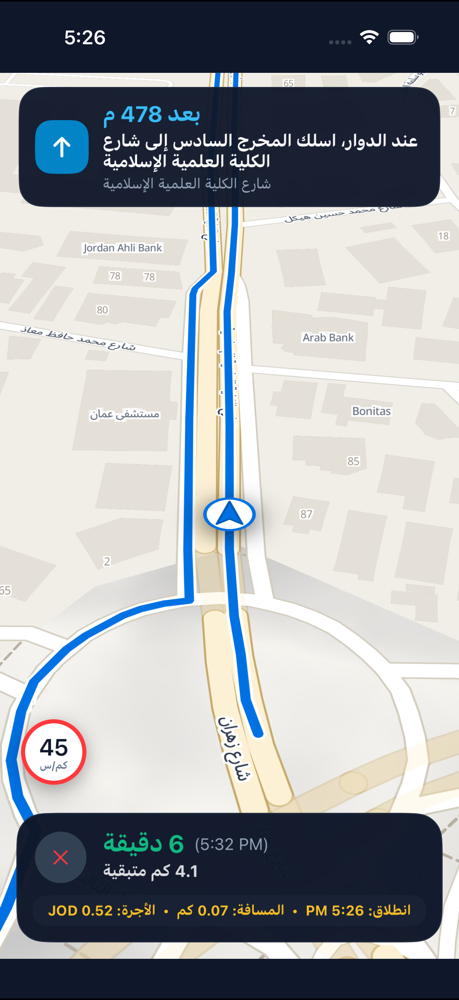
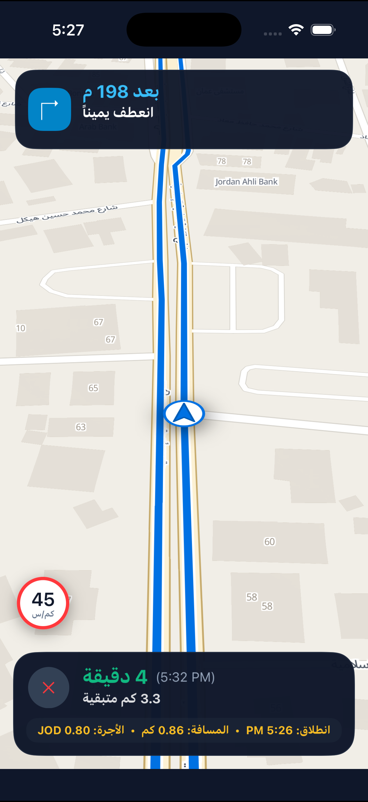

# Siro Nav for Android (Kotlin)
### حزمة الملاحة التوجيهية الحية لنظام أندرويد (Native Kotlin • SDK 21+)

[](https://jitpack.io/#Hamza-Ayed/siro-nav-android)
[](https://opensource.org/licenses/MIT)
[](https://kotlinlang.org)
[](https://developer.android.com)
[](https://map.intaleqapp.com)

حزمة ملاحة أصلية عالية الأداء مبنية بلغة **Kotlin** لنظام أندرويد، مخصصة لتطبيقات النقل والتوصيل (Ride-Hailing & Logistics). تمنح السائق تجربة ملاحة متكاملة على نمط خرائط سيرو (Siro Limestone 3D) مع الصوت العربي المسجل استوديو، التوجيه الذكي للدواوير والمخارج، واحتساب الأجرة لحظياً بالعملة المحددة.

---

## 📸 معاينة حية للمحرك (Live Visuals)

<div align="center">
  
  &nbsp;&nbsp;&nbsp;&nbsp;
  
</div>

- **خط المسار الأزرق الملاحي (Blue Route Polyline)**: مع إطار أبيض عالي التباين بسماكة 12px يلتف بانسيابية حول الدواوير والتقاطعات.
- **توجيه الدواوير الصوتي الذكي**: استخراج رقم المخرج ونطقه بالصوت الاستوديو العربي (`عند الدوار، اسلك المخرج السادس إلى شارع الكلية العلمية الإسلامية`).
- **ماركر السائق وسهم التوجيه**: قرص دائري أبيض بظل ثلاثي الأبعاد مع رأس سهم ملاحة أزرق يتجه فورياً مع زاوية الـ Heading.
- **لوحة الأجرة التراكمية المباشرة**: احتساب فتحة العداد، الكيلومترات، ودقائق الانتظار عند التوقف أو السرعة البطيئة.
- **عداد السرعة المرتفع**: شارة دائرية بارزة واضحة للسائق أثناء القيادة مع حلقة حمراء تحذيرية.

---

## 📦 التثبيت (Installation)

### ١. إضافة مستودع JitPack
في ملف `settings.gradle.kts` (أو `root build.gradle.kts`):

```kotlin
dependencyResolutionManagement {
    repositories {
        google()
        mavenCentral()
        maven { url = uri("https://jitpack.io") }
    }
}
```

### ٢. إضافة الاعتمادية
في ملف `build.gradle.kts` (Module: `app`):

```kotlin
dependencies {
    implementation("com.github.Hamza-Ayed:siro-nav-android:0.1.0")
}
```

---

## ⚡ البدء السريع في ٥ أسطر (Quick Start)

### ١. إعداد المتحكم وتحديد تسعيرة الرحلة للمطور (Fare Config)

```kotlin
import com.siro.nav.SiroNavController
import com.siro.nav.models.NavConfig
import com.siro.nav.billing.NavFareConfig

val config = NavConfig(
    apiKey = "YOUR_SIRO_API_KEY",
    baseUrl = "https://map-saas.intaleqapp.com/api"
)
val navController = SiroNavController(context = this, config = config)

// خيارات التسعير والفوترة للمطور
val fareConfig = NavFareConfig(
    baseFare = 0.50,            // فتحة العداد المبدئية
    perKilometer = 0.35,        // سعر الكيلومتر
    perWaitingMinute = 0.05,    // سعر دقيقة الانتظار (عند سرعة < 5 كم/س)
    currency = "JOD",           // العملة: JOD, SAR, AED, USD
    waitingSpeedKmh = 5.0
)

// بدء الملاحة
navController.startNavigation(route = activeRoute, fare = fareConfig)
```

### ٢. إضافة واجهة الملاحة في ملف التصميم XML

```xml
<com.siro.nav.view.SiroNavView
    android:id="@+id/siroNavView"
    android:layout_width="match_parent"
    android:layout_height="match_parent" />
```

### ٣. ربط الأحداث وتحديث الموقع من الـ GPS

```kotlin
val navView = findViewById<SiroNavView>(R.id.siroNavView)
navView.showFareMetrics = true

navController.listener = object : SiroNavListener {
    override fun onInstructionChanged(instruction: NavEvent.Instruction) {
        navView.updateInstruction(instruction)
    }

    override fun onProgressUpdated(progress: NavEvent.Progress) {
        navView.updateProgress(progress)
    }

    override fun onTripArrived(totals: NavTripTotals) {
        println("وصلت الرحلة! الأجرة الإجمالية: ${totals.fareLabel}")
        println("إجمالي المسافة: ${totals.totalDistanceKm} كم")
    }

    override fun onSpeedExceeded(currentSpeed: Double, speedLimit: Double) {}
    override fun onCameraApproaching(camera: SpeedCamera, distance: Double) {}
    override fun onError(error: String) {}
}

// تغذية الموقع من نظام GPS
fun onLocationReceived(location: Location) {
    navController.updateLocation(location)
}
```

---

## 🧪 تشغيل الاختبارات الآلية (Unit Tests)

```bash
./gradlew :siro-nav:testReleaseUnitTest
```

---

## 📄 الترخيص (License)
MIT License. © 2026 Siro Platform & Hamza Ayed.
